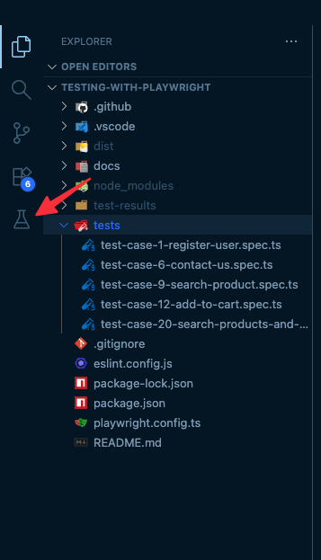
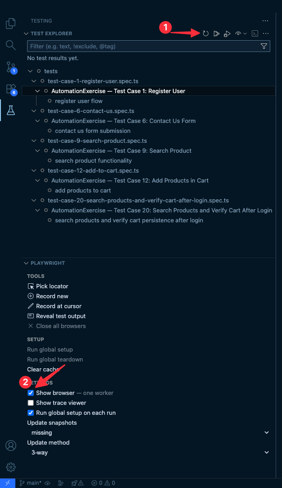

# Playwright E2E Testing Assignment: AutomationExercise

## 🎯 What You'll Build

You'll learn end-to-end (E2E) testing using Playwright by implementing automated tests for the [AutomationExercise website](https://www.automationexercise.com). This is a practice website specifically designed for automation testing, with real-world scenarios like user registration, login, product search, shopping cart management, and form submissions.

## 📚 Learning Objectives

By the end of this assignment, you will:

- **Master Playwright fundamentals** - locators, actions, assertions, and page interactions
- **Implement E2E test cases** - write comprehensive tests for web applications
- **Handle dynamic content** - work with forms, navigation, file uploads, and user interactions
- **Use modern testing patterns** - organize tests, handle async operations, and write maintainable test code
- **Debug and troubleshoot** - identify and fix test failures, understand error messages

## 🚀 Getting Started

### Prerequisites

- Node.js LTS installed
- Basic JavaScript knowledge (ES6+ features)
- Understanding of HTML/CSS and web development concepts
- Git installed and configured

### Setup

1. **Install project dependencies:**
   ```bash
   npm install
   ```

2. **Playwright browser installation:**
   Playwright browsers are automatically installed via the `postinstall` script in `package.json`.
   After running `npm install`, the script will automatically run `npx playwright install --with-deps chromium`.
   No additional steps needed!

3. **Explore the test files:**
   - Navigate to the `tests/` folder
   - You'll find 5 test files for different scenarios
   - Each test file contains a placeholder assertion followed by the steps you need to implement
   - Tests will fail until you implement them - this is expected!

4. **Run the tests (they will fail until implemented):**
   ```bash
   npm test
   ```
   This will run all E2E tests. The AutomationExercise test files are active but will fail until you implement them according to the steps in `test-cases.md`.

### VS Code: Recommended Extensions and Test Explorer

To get the best experience, install the workspace-recommended extensions listed in `.vscode/extensions.json`:

```json
{
  "recommendations": [
    "ms-playwright.playwright",
    "dbaeumer.vscode-eslint"
  ]
}
```

**Prerequisites:**
- Make sure you've run `npm install` first - this is required for tests to be discovered by the Testing panel

**Installation Steps:**
1. Open VS Code in this folder
2. When prompted, click "Install" on recommended extensions, or manually open the Extensions panel and install the above IDs
3. Wait for the Playwright extension to finish installing

**Using the Testing Panel:**

1. **Open the Testing panel:**
   - Click the **Testing icon (beaker flask)** in the left activity bar (see image below)

   

2. **Discover tests:**
   - Click the **Refresh Tests** icon (circular arrow) in the Test Explorer toolbar to discover all tests
   - You should see your 5 test cases appear in the Test Explorer panel

   

3. **Run tests:**
   - Click the **Run** icon (play button) next to any test or test suite to execute it
   - Or right-click on any test in the list and select "Run Test"
   - Test results will appear inline in the panel

4. **Additional features:**
   - Use the Playwright extension's "Show Trace" and UI mode for interactive debugging
   - Toggle "Show browser — one worker" in Playwright settings to see tests run in the browser

## 📋 Assignment Tasks

### Your Mission

Implement the test cases outlined in `tests/test-cases.md` for the AutomationExercise website. You'll be working with real-world testing scenarios:

1. **Test Case 1: Register User** - Complete user registration flow with account creation and deletion
2. **Test Case 6: Contact Us Form** - Form submission with file upload functionality
3. **Test Case 9: Search Product** - Product search and results verification
4. **Test Case 12: Add Products in Cart** - Shopping cart functionality with multiple products
5. **Test Case 20: Search Products and Verify Cart After Login** - Cart persistence after authentication

### Test Files to Implement

Each test file in `tests/` contains:
- A test suite with a deliberately failing `TODO` assertion
- All numbered steps are documented in `tests/test-cases.md`
- Tests are active and will fail until you implement them

**Files to work on:**
- `tests/test-case-1-register-user.spec.ts`
- `tests/test-case-6-contact-us.spec.ts`
- `tests/test-case-9-search-product.spec.ts`
- `tests/test-case-12-add-to-cart.spec.ts`
- `tests/test-case-20-search-products-and-verify-cart-after-login.spec.ts`

### Getting Started with a Test

All test suites are active by default and initially fail with a clear `TODO` message. Remove the placeholder assertion from a test only when you begin implementing that test's steps.

1. **Navigate to the website:**
   ```typescript
   await page.goto('https://www.automationexercise.com');
   ```

2. **Implement each step:**
   - Read the comment for each step
   - Write the Playwright code to perform that action
   - Add assertions where verification is required

3. **Example implementation pattern:**
   ```typescript
   test('register user flow', async ({ page }) => {
     // Navigate
     await page.goto('https://www.automationexercise.com');
     
     // Verify home
     await expect(page).toHaveTitle(/Automation Exercise/);
     
     // Begin flow
     await page.click('text=Signup / Login');
     
     // ... continue with remaining steps
   });
   ```

## 🧪 Running Tests

### Run All Tests (will fail until implemented)
```bash
npm test
```

### Run Only E2E Tests
```bash
npm run test:e2e
```

### Run Tests in UI Mode (Interactive)
```bash
npx playwright test --ui
```

### Run a Specific Test File
```bash
npx playwright test tests/test-case-1-register-user.spec.ts
```

### Run Tests in Debug Mode
```bash
npx playwright test --debug
```

### Run Tests in Headed Mode (See Browser)
```bash
npx playwright test --headed
```

## 📖 Test Cases Reference

All test case steps are documented in `tests/test-cases.md`. Each test case includes:
- Numbered steps with clear instructions
- Expected outcomes and verifications
- Specific UI elements to interact with

**Reference Website:** [AutomationExercise Test Cases](https://www.automationexercise.com/test_cases)

## 💡 Tips for Success

### Finding Elements
- Use Playwright's codegen tool to generate selectors:
  ```bash
  npx playwright codegen https://www.automationexercise.com
  ```
- Prefer semantic selectors (text, role, label)
- Use data-testid if available
- Avoid brittle CSS selectors when possible

### Handling Async Operations
- Always use `await` with Playwright actions
- Wait for navigation: `await page.waitForURL(/pattern/)`
- Wait for elements: `await page.waitForSelector('selector')`

### Debugging
- Use `page.pause()` to pause execution at a specific point
- Take screenshots: `await page.screenshot({ path: 'screenshot.png' })`
- Log page content: `console.log(await page.content())`

### Best Practices
- Keep tests independent (don't rely on execution order)
- Use descriptive test names and comments
- Handle dynamic content (wait for elements to appear)
- Clean up test data when possible (e.g., delete test accounts)

## 📋 Submission Checklist

Before submitting, verify:

- [ ] All 5 test cases are implemented and passing
- [ ] All test steps from `test-cases.md` are implemented
- [ ] Tests pass consistently (`npm test`)
- [ ] Tests are independent and can run in any order
- [ ] Code is clean and well-commented
- [ ] Assertions verify expected behavior
- [ ] Tests handle edge cases appropriately
- [ ] All commits are pushed to your private course repository
- [ ] The private repository URL is submitted in Canvas

Canvas accepts the private repository URL only. A text response, local-only commit, GitHub Pages site, or automated GitHub Actions result is not a submission. Run all checks locally and push your final work to the repository provisioned for you in the `IT3049C-26FS` organization.

## 📊 Grading (20 points)

- Test Case 1: Register User — 4 points
- Test Case 6: Contact Us Form — 3 points
- Test Case 9: Search Product — 2 points
- Test Case 12: Add Products in Cart — 3 points
- Test Case 20: Search Products and Verify Cart After Login — 4 points
- Test quality: semantic locators, meaningful assertions, async handling, independence, and responsible test data — 3 points
- Repository workflow: meaningful commits, clean code, and the correct private repository submission — 1 point

## 🎓 Key Concepts

### Playwright Basics
- **Locators** - Finding elements on the page
- **Actions** - Clicking, typing, hovering, etc.
- **Assertions** - Verifying expected state
- **Navigation** - Moving between pages
- **Waiting** - Handling async operations

### Testing Patterns
- **Page Object Model** - Organizing selectors and actions (optional for this assignment)
- **Test Data Management** - Using unique values for forms (timestamps, random strings)
- **Error Handling** - Graceful failure and cleanup

### Common Selectors
```typescript
// By text
page.locator('text=Signup / Login')

// By role
page.getByRole('button', { name: 'Submit' })

// By label
page.getByLabel('Email')

// By placeholder
page.getByPlaceholder('Enter email')

// By test id
page.getByTestId('submit-button')

// By CSS selector (use sparingly)
page.locator('#element-id')
```

## 🔗 Resources

### Documentation
- [Playwright Documentation](https://playwright.dev/)
- [Playwright API Reference](https://playwright.dev/docs/api/class-playwright)
- [Playwright Best Practices](https://playwright.dev/docs/best-practices)

### Practice Website
- [AutomationExercise Homepage](https://www.automationexercise.com)
- [AutomationExercise Test Cases](https://www.automationexercise.com/test_cases)

### Learning
- [Playwright Getting Started](https://playwright.dev/docs/intro)
- [Playwright Test Generator](https://playwright.dev/docs/codegen)

## ⚠️ Important Notes

- **The website is public** - Be respectful with test data (e.g., use unique email addresses)
- **Tests may be slow** - The website may have rate limiting, add delays if needed
- **Test isolation** - Each test should be independent; don't rely on previous test state
- **Local testing** - Run the checks on your computer. No GitHub Actions or deployment is required.

## 🎉 Getting Help

If you get stuck:

1. **Read the error messages carefully** - Playwright provides detailed error information
2. **Use Playwright Inspector** - Run tests with `--debug` flag
3. **Check the website** - Manually perform the steps to understand the flow
4. **Review test-cases.md** - Ensure you understand each step
5. **Consult Playwright docs** - Most questions are answered in the official documentation

## 🎓 Success Criteria

You'll know you've succeeded when:

- ✅ All 5 test cases run and pass
- ✅ All tests pass consistently
- ✅ Tests follow the steps in the comments above the test suite
- ✅ Code is readable and maintainable
- ✅ You can explain what each test does

Good luck, and happy testing! 🚀
